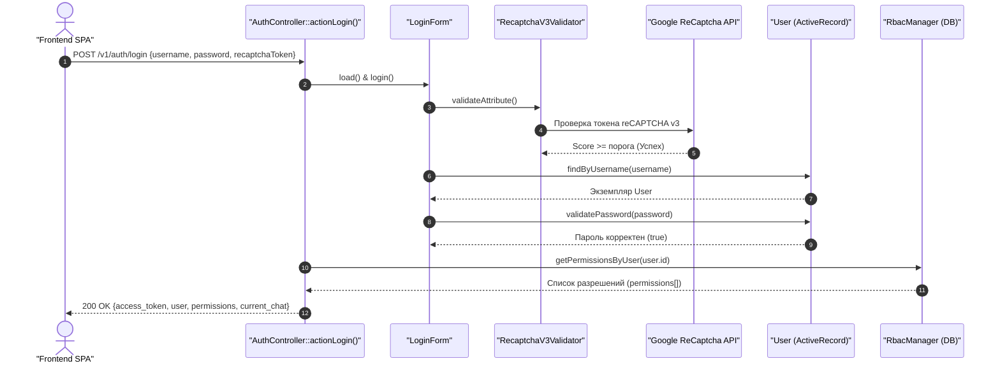

# Механизм: Авторизация, аутентификация и RBAC

## 1. Назначение механизма
Обеспечивает безопасный вход пользователей в систему с проверкой Google ReCaptcha v3, выдачу Bearer токена доступа (`auth_key`), проверку ролей и прав пользователя в разрезе компаний (Multi-tenant RBAC).

---

## 2. Точки входа (Entrypoints)

* **HTTP Method & URL:** `POST /v1/auth/login`
* **Контроллер:** `api/controllers/v1/AuthController.php`
* **Метод действия:** `actionLogin()`
* **Фильтры безопасности:** `api/controllers/RestController.php` (`HttpBearerAuth`, `Cors`)

---

## 3. Таблица задействованных файлов и функций

| Роль | Файл | Метод / Функция | Описание действия |
| :--- | :--- | :--- | :--- |
| **HTTP Entrypoint** | `api/controllers/v1/AuthController.php` | `actionLogin()` | Принимает тело запроса (`username`, `password`, `recaptchaToken`), передает в форму |
| **Валидация формы** | `api/models/forms/LoginForm.php` | `rules()`, `validatePassword()` | Проверяет reCAPTCHA v3, проверяет хеш пароля через `User::validatePassword()` |
| **Валидатор Капчи** | `api/components/RecaptchaV3Validator.php` | `validateAttribute()` | Делает верификационный запрос к Google API reCAPTCHA v3 |
| **Модель Пользователя** | `common/models/User.php` | `findByUsername()`, `validatePassword()`, `getAuthKey()` | Извлекает запись пользователя из MySQL, проверяет Bcrypt-хеш, возвращает токен |
| **Формирование ответа** | `api/controllers/v1/AuthController.php` | `userAccessToken()` | Собирает профиль пользователя, компанию, активный чат и права RBAC |
| **Менеджер прав (RBAC)**| `common/components/RbacManager.php` | `getPermissionsByUser($userId)` | Загружает назначенные пользователю разрешения и роли с учетом ID компании |
| **Проверка Bearer токена**| `api/controllers/RestController.php` | `behaviors()['authenticator']` | Перехватывает каждый последующий запрос и проверяет заголовок `Authorization: Bearer <token>` |

---

## 4. Схема выполнения (Sequence Diagram)

---

## 5. Инициализация ролей (RBAC Seeding)
Первичная генерация иерархии ролей и прав запускается из CLI:
* **Команда:** `php yii rbac/init`
* **Файл:** `console/controllers/RbacController.php`
* **Метод:** `actionInit()`
* Создает роли: суперадминистратор, директор, менеджер, кладовщик, согласующий и наполняет их операциями над каталогом, заказами и бюджетами.
