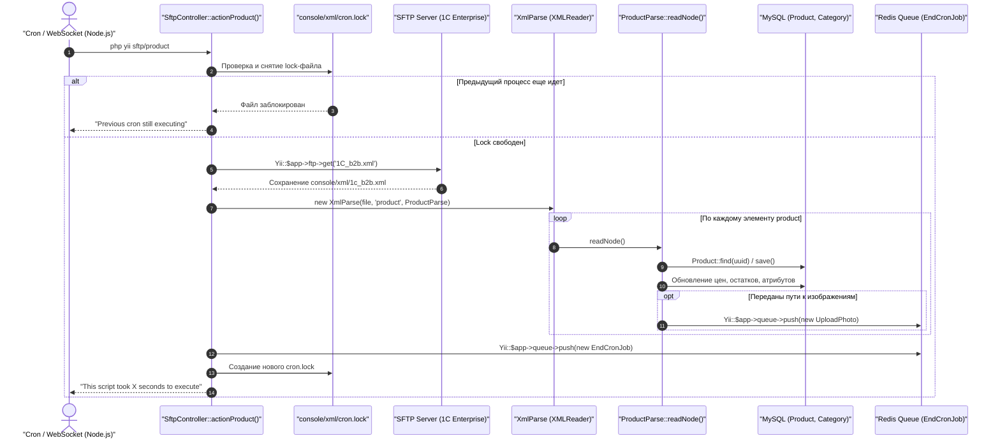

# Механизм: Синхронизация каталога и товаров из 1С (SFTP & XML)

## 1. Назначение механизма
Обеспечивает выгрузку и обновление номенклатуры товаров, остатков, цен, категорий, единиц измерения и изображений из корпоративной системы 1С Enterprise на платформу Salvi.

---

## 2. Точки входа (Entrypoints)

* **CLI Команда:** `php yii sftp/product`
* **Файл точки входа:** `console/controllers/SftpController.php`
* **Метод действия:** `actionProduct()`
* **Альтернативный триггер:** Событие WebSocket `updateOneS` от авторизованного пользователя через `nodejs/socket.js`.

---

## 3. Таблица задействованных файлов и функций

| Роль | Файл | Метод / Класс | Что делает |
| :--- | :--- | :--- | :--- |
| **CLI Контроллер** | `console/controllers/SftpController.php` | `actionProduct()` | Проверяет lock-файл, устанавливает лимит памяти 512M, управляет этапами обмена |
| **Lock-контроль** | `console/controllers/SftpController.php` | `unlink()`, `fopen('cron.lock')` | Защита от параллельного запуска нескольких сессий синхронизации |
| **SFTP Клиент** | `common/config/main.php` (`ftp`) | `Yii::$app->ftp->get()` | Скачивает свежий XML-файл обмена с внешнего SFTP-сервера `94.130.177.104:22321` |
| **Потоковый XML Парсер** | `common/helpers/XmlParse.php` | `read()` | Читает объемный XML по частям с использованием `XMLReader`, предотвращая переполнение памяти |
| **Парсер номенклатуры** | `common/helpers/xml/ProductParse.php` | `readNode()`, `groups()`, `prices()` | Парсит структуру XML-узла: атрибуты, цены, остатки, свойства |
| **Модель Товара** | `common/models/Product.php` | `save()`, `find()` | Находит товар по `uuid` (из 1С) или создает новый, сохраняет цены и характеристики |
| **Категории и связи** | `common/models/ProductCategory.php` | `save()` | Связывает товар с иерархией дерева категорий |
| **Форма импорта товара**| `api/models/integration/ProductForm.php` | `save()` | Валидирует и сохраняет товар, ставит задачу `UploadPhoto` в очередь |
| **Форма импорта категории**| `api/models/integration/CategoryForm.php`| `save()` | Валидирует и сохраняет категорию, ставит задачу `UploadPhotoCategory` в очередь |
| **Очередь фото товара**| `api/job/UploadPhoto.php` | `execute()` | Асинхронно скачивает картинку по SFTP, конвертирует PNG->JPG, пишет в `ProductPhoto`, сбрасывает кэш |
| **Очередь фото категории**| `api/job/UploadPhotoCategory.php` | `execute()` | Скачивает иконку из `/upload/treeicons/` по SFTP, обновляет `Category::$img_path`, сбрасывает кэш дерева |
| **Завершающая очередь** | `api/job/EndCronJob.php` | `execute()` | Отправляет в Redis задачу фиксации времени выполнения и постобработки |

---

## 4. Схема выполнения (Sequence Diagram)



---

## 5. Асинхронная загрузка изображений товаров и категорий через очереди

Загрузка фотографий вынесена из основного потока импорта в асинхронные задачи очереди Redis (`yii\queue\redis\Queue`), чтобы процесс разбора XML/JSON не блокировался скачиванием сотен тяжелых файлов по сети.

### 5.1. Загрузка фото товаров: `api/job/UploadPhoto.php`
* **Постановка в очередь:** выполняется в `api/models/integration/ProductForm.php` при сохранении товара:
  ```php
  if ($this->image) {
      Yii::$app->queue->push(new UploadPhoto([
          'product' => $product,
          'images'  => $this->image // путь или массив путей к файлам на SFTP
      ]));
  }
  ```
* **Выполнение задачи воркером (`execute()`):**
  1. **Удаление старых фото (`deleteImages()`):** удаляет существующие файлы товара из директории `@api/web/product/` и удаляет связанные записи из таблицы `product_photo`.
  2. **Скачивание файла по SFTP:** через `Yii::$app->ftp->get($remotePath, $fileFullPath, FTP_ASCII, false)`. Если файл не найден или пустой (0 байт), операция прерывается с логированием.
  3. **Удаление исходника с SFTP:** после успешного скачивания файл удаляется с удаленного сервера через `Yii::$app->ftp->delete($remotePath)`.
  4. **Конвертация в JPEG:** если файл имеет расширение `.png`, утилита [`ImageConvertHelper::convertPngToJpg()`](file:///C:/Users/Admin/PhpstormProjects/salvi_back/common/helpers/ImageConvertHelper.php) конвертирует его в `.jpg` и удаляет исходный `.png`.
  5. **Сохранение в БД:** генерируется уникальное имя на основе `Uuid::uuid4()`, создается запись `ProductPhoto` (`product_id`, `product_uuid`, `name`).
  6. **Инвалидация тегированного кэша:** автоматически сбрасываются теги кэша каталога в Redis:
     `GetSeasonGoods`, `CategoryPopular`, `Get4BlockCategories`, `GetCategoryPage`, `GetProductByCategoryOnCategoryPage`.
  7. **Логирование:** результат фиксируется в персональном логе товара: `@api/runtime/logs/products_photo/{product_id}.log`.

### 5.2. Загрузка иконок категорий: `api/job/UploadPhotoCategory.php`
* **Постановка в очередь:** выполняется в `api/models/integration/CategoryForm.php` при сохранении категории:
  ```php
  if ($this->image) {
      Yii::$app->queue->push(new UploadPhotoCategory([
          'category' => $category,
          'image'    => $this->image
      ]));
  }
  ```
* **Выполнение задачи воркером (`execute()`):**
  1. Из переданного пути извлекается имя файла (например, `icon_name.png`).
  2. Скачивается иконка с SFTP-сервера из папки `/upload/treeicons/{filename}` в локальный каталог `@api/web/category/`.
  3. После успешной проверки удаляет файл с SFTP (`Yii::$app->ftp->delete('/upload/treeicons/' . $fileName)`).
  4. При необходимости конвертирует `.png` в `.jpg`.
  5. Удаляет старую иконку с диска `@api/web/category/{old_file}`.
  6. Обновляет атрибут `$categoryDb->img_path = $name` и сохраняет категорию в MySQL.
  7. Инвалидирует кэш дерева категорий `TagDependency::invalidate(Yii::$app->cache, 'CategoryTreeAllCategories')`.

---

## 6. Особенности и параметры конфигурации
* **SFTP параметры:** задаются в `common/config/main.php` в компоненте `ftp` (`user: fileuploader`, хост `94.130.177.104`, порт `22321`).
* **Каталоги хранения на диске:**
  * Фото товаров: `api/web/product/`
  * Иконки категорий: `api/web/category/`
* **Хранилище XML:** `console/xml/1c_b2b.xml`.
* **Lock-файл:** `console/xml/cron.lock` предотвращает наложение повторных запусков при долгом парсинге.
