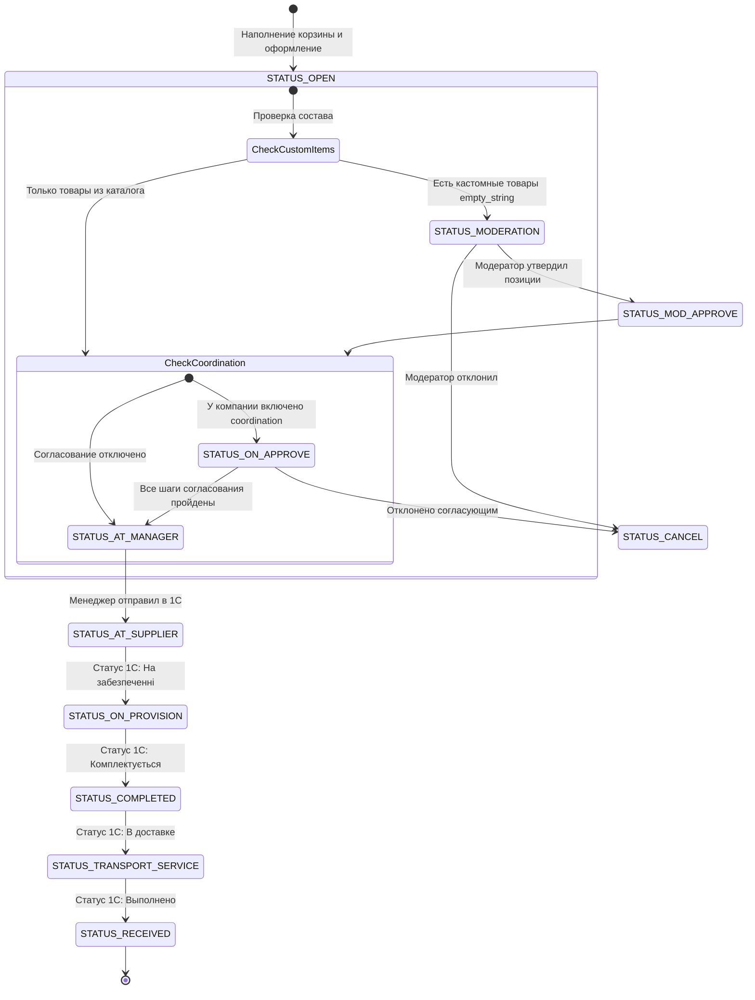
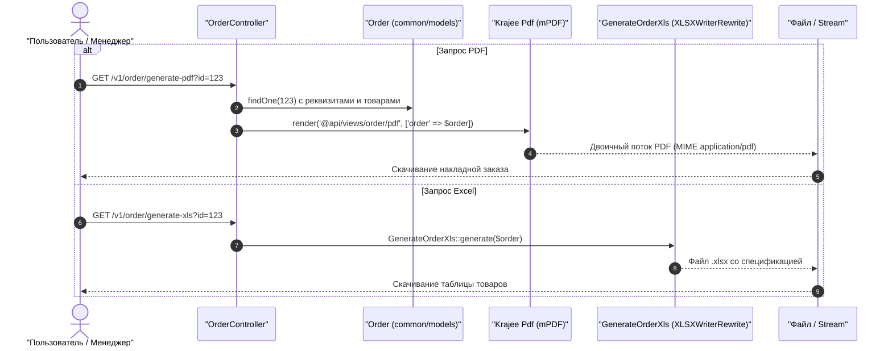

# Механизм: Жизненный цикл заказа (Order Lifecycle)

## 1. Назначение механизма
Управляет полным циклом движения клиентского заказа в B2B-системе Salvi: от добавления товаров в корзину и проверки бюджетов до многоэтапного согласования, модерации, разделения на подзаказы и генерации первичных документов (XLSX, PDF).

---

## 2. Основные точки входа (Entrypoints)

| Этап / Действие | HTTP Метод | URL | Метод контроллера |
| :--- | :--- | :--- | :--- |
| **Создание заказа** | `POST` | `/v1/order/create` | `OrderController::actionCreate()` |
| **Отправка на согласование** | `POST` | `/v1/order/set-status-on-approve` | `OrderController::actionSetStatusOnApprove()` |
| **Согласование (руководитель)**| `POST` | `/v1/order/approve-coordination` | `OrderController::actionApproveCoordination()` |
| **Модерация (менеджер)** | `POST` | `/v1/order/approve-moderation` | `OrderController::actionApproveModeration()` |
| **Разделение заказа** | `POST` | `/v1/order/split-order` | `OrderController::actionSplitOrder()` |
| **Отправка поставщику** | `POST` | `/v1/order/send-to-supplier` | `OrderController::actionSendToSupplier()` |
| **Экспорт в PDF (Накладная)**| `GET` | `/v1/order/generate-pdf` | `OrderController::actionGeneratePdf()` |
| **Экспорт в Excel (XLSX)** | `GET` | `/v1/order/generate-xls` | `OrderController::actionGenerateXls()` |

---

## 3. Таблица задействованных файлов и функций

| Роль | Файл | Класс / Функция | Что делает |
| :--- | :--- | :--- | :--- |
| **HTTP Контроллер** | `api/controllers/v1/OrderController.php` | `actionCreate()` | Проверяет право `createOrder`, валидирует форму, инициирует создание заказа |
| **Форма создания заказа** | `api/models/forms/OrderForm.php` | `create()` | Проверяет лимиты бюджета (`Budget`), остатки, переносит позиции из корзины в заказ |
| **Проверка бюджета** | `common/models/Budget.php` | `checkBudget()` | Проверяет доступность средств по ЦФО (Cost Center) и периоду |
| **Модель Заказа** | `common/models/Order.php` | `save()`, `copyOrder()` | Основная сущность заказа: статус, сумма, адрес доставки, контрагент |
| **Товары заказа** | `common/models/OrderProduct.php` | `save()` | Позиции заказа, цены на момент фиксации, статус согласования позиции |
| **Сервис согласования** | `api/services/OrderCoordinationHelper.php` | `coordinate()` | Выстраивает цепочку согласующих лиц согласно структуре компании |
| **Генерация PDF** | `api/controllers/v1/OrderController.php` | `actionGeneratePdf()` | Рендерит view и компилирует PDF через Krajee `mPDF` |
| **Генерация XLSX** | `api/services/GenerateOrderXls.php` | `generate()` | Формирует спецификацию заказа через `XLSXWriterRewrite` (быстрый потоковый экспорт) |

---

## 4. Карта и смета статусов заказа (11 статусов)

В системе определены 11 состояний заказа ([`common\models\Order::statuses()`](file:///C:/Users/Admin/PhpstormProjects/salvi_back/common/models/Order.php#L180-L252)), которые отображаются в UI бейджами соответствующих цветов и маппятся на статусы учетной системы 1С:

| ID | Константа | Название в UI | Цвет и CSS класс | Описание и условия перехода | Статус в 1С |
| :---: | :--- | :--- | :--- | :--- | :---: |
| **`0`** | `STATUS_OPEN` | **Відкрите** | `#FCBD00` (`orange`) | Заказ сформирован клиентом из корзины. Редактируется до отправки. | — |
| **`5`** | `STATUS_MODERATION` | **Запит товарів** | `#F9D835` (`yellow`) | Если в заказе есть кастомные товары («пустая строка» `empty_string`), заказ отправляется менеджеру Salvi на модерацию и согласование цен. | — |
| **`6`** | `STATUS_MOD_APPROVE` | **Модеровано** | `#9A7171` (`brown`) | Менеджер Salvi проверил нестандартные позиции, назначил поставщика и подтвердил цены. | — |
| **`1`** | `STATUS_ON_APPROVE` | **На узгодженні** | `#F24949` (`red`) | Заказ проходит внутреннюю цепочку согласования (Matching) руководителями компании клиента. | — |
| **`4`** | `STATUS_AT_MANAGER` | **На затвердженні постачальником** | `#7F96E2` (`violet`) | Внутреннее согласование пройдено! Заказ ожидает подтверждения менеджером Salvi перед передачей на склад. | — |
| **`2`** | `STATUS_AT_SUPPLIER` | **Передане постачальнику** | `#5578EB` (`blue`) | Заказ успешно выгружен в 1С / передан поставщику на сборку. | **1** |
| **`7`** | `STATUS_ON_PROVISION` | **На забезпеченні** | `#82c2b4` (`light-blue`) | Ожидается поставка отсутствующих позиций на распределительный склад. | **2** |
| **`8`** | `STATUS_COMPLETED` | **Комплектується** | `#dae060` (`yellow-green`) | Все товары на складе, идет комплектация и упаковка посылки. | **3** |
| **`9`** | `STATUS_TRANSPORT_SERVICE`| **Передано у транспортну службу**| `#8bd938` (`light-green`) | Посылка передана перевозчику (Новая Почта / курьер) для доставки. | **4** |
| **`3`** | `STATUS_RECEIVED` | **Виконано** | `#64DD17` (`green`) | Заказ доставлен и успешно принят клиентом. | **5** |
| **`10`**| `STATUS_CANCEL` | **Скасовано** | `#ff7b5a` (`light-brown`) | Заказ отменен клиентом, согласующим или менеджером. Резервы бюджета возвращаются. | — |

---

## 5. Схема жизненного цикла заказа

---

## 6. Схема генерации документов (PDF / Excel)

