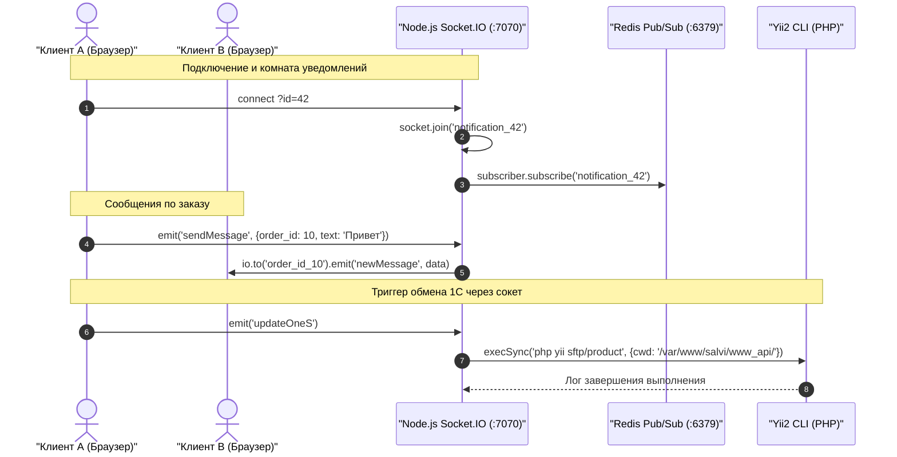

# Механизм: Real-time WebSocket сервер (Node.js + Redis Pub/Sub)

## 1. Назначение механизма
Обеспечивает двустороннюю связь в реальном времени между клиентскими браузерами и сервером без постоянного опрашивания (polling):
* Мгновенные push-уведомления пользователям
* Чат по конкретному заказу и общий корпоративный чат
* Синхронизация состояния корзины между вкладками или коллегами
* Уведомления об изменении прав доступа
* Удаленный вызов консольных команд (синхронизация с 1С)

---

## 2. Точки входа и сетевая топология

* **Сетевой порт:** `7070` (TCP, WebSocket / HTTP)
* **Процесс-менеджер:** `forever` (под управлением `/var/www/salvi/node.sh`)
* **Точка входа кода:** `nodejs/index.js` -> `nodejs/socket.js`
* **Брокер сообщений:** Redis 6.0 (`127.0.0.1:6379`)

---

## 3. Таблица комнат и событий WebSocket

| Событие / Канал | Направление | Комната Socket.io | Назначение |
| :--- | :--- | :--- | :--- |
| `connection?id={uid}` | Client -> Server | `notification_{id}` | Подключение пользователя и подписка на личные уведомления |
| `userCartAction` | Client -> Server | `cartChannel` | Передача действия в корзине (добавление, удаление товара) |
| `sendMessage` | Client -> Server | `order_id_{order_id}` | Сообщение в чате конкретного заказа |
| `chatMessage` | Client -> Server | `chat` | Сообщение в общем корпоративном чате |
| `orderChangeSuccess`| Client -> Server | `orderChanged` | Оповещение об успешной модификации заказа |
| `setPermissions` | Client -> Server | `permissions_chanel`| Сброс и повторный запрос прав доступа в UI |
| `updateOneS` | Client -> Server | — | **Вызов команды на сервере:** `php yii sftp/product` |
| **Redis Bridge** | Redis -> Server | Любой канал Redis | Любое сообщение из Redis пересылается в Socket.io: `io.emit(channel, message)` |

---

## 4. Схема работы моста Node.js <-> Redis <-> Yii2



---

## 5. Управление демоном на сервере
Скрипт `/var/www/salvi/node.sh`:
```bash
# Проверить статус демона:
cd /var/www/salvi && ./node.sh LIST

# Перезапустить при обновлении кода:
cd /var/www/salvi && ./node.sh STOP
cd /var/www/salvi && ./node.sh START
```
Логи демона пишутся в домашнюю директорию `salvi/.forever/`.
