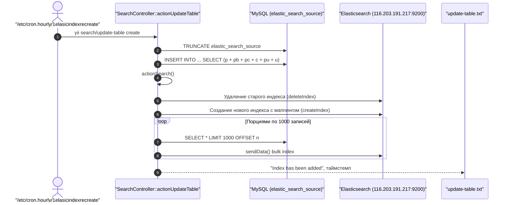

# Механизм: Фоновые очереди и Cron-задачи

## 1. Назначение механизма
Обеспечивает регулярное регламентное обслуживание данных и асинхронное выполнение ресурсоемких операций:
1. **Почасовое регламентное обслуживание (Production Cron):**
   * Актуализация поискового индекса каталога товаров в **Elasticsearch**.
   * Мониторинг сроков действия клиентских контрактов и рассылка предупреждений.
   * Ротация дисковых логов и очистка устаревших уведомлений в БД.
2. **Ежесуточное обслуживание бюджетов:** открытие и закрытие периодов бюджетирования в полночь.
3. **Асинхронные очереди (Yii Queue):** отправка email, геокодинг адресов, фоновый парсинг прайсов и обработка фото.

---

## 2. Почасовой планировщик: `/etc/cron.hourly/1elasicindexrecreate`

На сервере скрипт размещен в `/etc/cron.hourly/1elasicindexrecreate` и запускается каждый час операционной системой от имени `root`:

```bash
#!/bin/sh
/usr/bin/php /var/www/salvi/www_api/yii search/update-table create >> /var/www/salvi/www_api/update-table.txt
/usr/bin/php /var/www/salvi/www_api/yii contract >> /var/www/salvi/www_api/contract.txt
/usr/bin/php /var/www/salvi/www_api/yii clear-logs >> /var/www/salvi/www_api/clear-logs.txt
```

---

### 2.1. Механизм 1: Переиндексация каталога (`search/update-table create`)

* **Консольная команда:** `php yii search/update-table create`
* **Файл точки входа:** `console/controllers/SearchController.php`
* **Метод старта:** `actionUpdateTable($arg = 'create')`
* **Вспомогательные методы:** `actionSearch()`, `createIndex()`, `sendData()`
* **Лог-файл выполнения:** `/var/www/salvi/www_api/update-table.txt`
* **Выделенный сервер Elasticsearch:** `116.203.191.217:9200` (клиент: `Elasticsearch\ClientBuilder`)

#### Пошаговая цепочка выполнения:
1. **Очистка промежуточной таблицы:** выполняется `TRUNCATE TABLE elastic_search_source`.
2. **Сбор плоской витрины данных:** выполняется `INSERT INTO elastic_search_source SELECT ...` через массивный `LEFT JOIN`:
   * Таблицы: `product p`, `product_brand pb`, `product_photo pp`, `product_category pc`, `category c`, `product_uktzed pu`, `unit u`.
   * Фильтрация: исключаются удаленные категории (`c.delete = 0`) и скрытые товары (`p.deleted != STATUS_HIDDEN`).
   * Поля: артикул (`sku`), наименование, синонимы, бренд, категория, фото, цена, код УКТВЭД.
3. **Триггер индексатора:** так как передан параметр `'create'`, контроллер вызывает `$this->actionSearch()`.
4. **Удаление и пересоздание индекса:** индекс `{env}.salvi.ua.search` удаляется (`deleteIndex`) и создается заново с правильными маппингами анализаторов (`createIndex`).
5. **Пакетная отправка (Batching):** данные из `elastic_search_source` читаются страницами по **1000 записей** (`LIMIT 1000 OFFSET ...`) и отправляются в Elasticsearch через `sendData($element)`.
6. **Оповещение об ошибках:** в случае сбоя при индексации на prod отправляется экстренное письмо администраторам через `UserEmailHelper::defaultMessage`.



---

### 2.2. Механизм 2: Контроль срока действия контрактов (`contract`)

* **Консольная команда:** `php yii contract`
* **Файл точки входа:** `console/controllers/ContractController.php`
* **Метод старта:** `actionIndex()`
* **Лог-файл выполнения:** `/var/www/salvi/www_api/contract.txt`

#### Пошаговая цепочка выполнения:
1. Запускается приватный метод `$this->sevenDays()`.
2. Вычисляется временное окно: от текущего момента `time()` до `+7 дней`.
3. Запрашиваются все активные контракты:
   ```php
   Contract::find()
       ->where(['<', 'date_end', $timeTo])
       ->andWhere(['>', 'date_end', $timeFrom])
       ->andWhere(['=', 'status', 1])
       ->all();
   ```
4. **Антиспам-проверка:** анализируется поле `date_send_noty_end`. Если уведомление уже отправлялось менее 7 дней назад, повторная отправка блокируется (`$canResendNoty = false`).
5. **Отправка уведомления:** через `api\helpers\NotificationHelper::soonEndContractCompany($contract, '7 днів')` формируется системное оповещение и письмо ответственным лицам компании.
6. **Фиксация даты:** поле `$contract->date_send_noty_end` обновляется текущим `time()` и сохраняется в БД.
7. В лог `contract.txt` записываются ID выбранных и обработанных договоров.

---

### 2.3. Механизм 3: Очистка и ротация логов (`clear-logs`)

* **Консольная команда:** `php yii clear-logs`
* **Файл точки входа:** `console/controllers/ClearLogsController.php`
* **Метод старта:** `actionIndex()`
* **Лог-файл выполнения:** `/var/www/salvi/www_api/clear-logs.txt`

#### Что именно очищается:

| Объект очистки | Путь / Таблица | Критерий удаления | Цель |
| :--- | :--- | :--- | :--- |
| **Системные нотификации** | Таблица `notification` | `created_at < now - 30 days` | Очистка устаревших прочитанных и скрытых алертов в MySQL |
| **Лог интеграций** | `/var/www/salvi/www_api/api/runtime/logs/integration.log` | Размер файла > **400 МБ** | Защита диска от переполнения гигантским логом |
| **Логи загрузки товаров** | `/var/www/salvi/www_api/api/runtime/logs/products/upload_*.log` | Старше **3 месяцев** | Удаление старых текстовых отчетов импорта номенклатуры |
| **Логи спецификаций** | `/var/www/salvi/www_api/api/runtime/logs/specification/upload_*.log`| Старше **3 месяцев** | Ротация логов импорта спецификаций |
| **XML и JSON архивы заказов**| `/var/www/salvi/www_api/console/xml/orders/orders_*.(json\|xml)` | Старше **3 месяцев** | Чистка временных экспортированных файлов обмена |
| **Логи фото товаров** | `/var/www/salvi/www_api/api/runtime/logs/products_photo/*.log` | Старше **3 недель** | Чистка логов нарезки и оптимизации изображений |

---

## 3. Расписание Crontab пользователя `salvi`

Файл расписания: `/var/spool/cron/salvi`

| Расписание | Команда | Файл / Метод | Что делает |
| :--- | :--- | :--- | :--- |
| `0 0 * * *` (ежедневно в полночь) | `php /var/www/salvi/www_api/yii budget/index;` | `console/controllers/BudgetController.php::actionIndex()` | **Управление статусами бюджетов:** переводит наступившие бюджеты в `STATUS_ACTIVE` и переводит истекшие в `STATUS_INACTIVE`. |
| `@reboot` | `cd /var/www/salvi/ && ./node.sh START` | `/var/www/salvi/node.sh` | Подъем WebSocket-демона `forever` на порту 7070 после ребута сервера. |

---

## 4. Архитектура очередей (Yii Queue)

* **Драйвер:** Redis (`yii\queue\redis\Queue`), зарегистрирован в `common/config/main.php`.
* **Канал:** `queue`
* **Демон воркера:** Systemd `yii-queue@1.service`:
  ```bash
  /usr/bin/php /var/www/salvi/www_api/yii queue/listen --verbose
  ```

### Реестр классов фоновых задач (`api/job/`):

| Класс задачи | Источник / Триггер | Метод `execute()` | Описание действия |
| :--- | :--- | :--- | :--- |
| **`SendEmail`** | Регистрация, смена пароля, заказы | `UserEmailHelper::sendMsg()` | Асинхронная отправка email через SMTP MiroHost |
| **`GetCoordinate`** | Добавление локации `Locations` | `GoogleMapsHelper::getCoordinate()` | Запрос координат в Google Maps API и запись `lat`, `lng` |
| **`LocationAddedJob`** | Событие `Locations::EVENT_AFTER_INSERT`| Создает `GetCoordinate` | Инициирует поиск координат при добавлении точки доставки |
| **`DeleteProductJob`** | Событие `Product::EVENT_AFTER_UPDATE` | Удаление / сокрытие | Очищает связи и скрывает товар из каталога |
| **`ParseXlsxJob`** | Загрузка XLSX в панели | `XlsxParser` | Построчный разбор прайс-листа Excel |
| **`UploadPhoto`** | Импорт товаров (ProductForm / SFTP) | `Yii::$app->ftp->get()`, `convertPngToJpg()` | Скачивание фото по SFTP, конвертация PNG->JPG, сохранение в `ProductPhoto`, сброс кэша каталога |
| **`UploadPhotoCategory`** | Импорт категорий (CategoryForm / SFTP) | `Yii::$app->ftp->get()`, `convertPngToJpg()` | Скачивание иконки из `/upload/treeicons/` по SFTP, сохранение в `Category::$img_path`, сброс кэша дерева |
| **`EndCronJob`** | Завершение `sftp/product` | Логирование метрик | Фиксация длительности цикла обмена |
