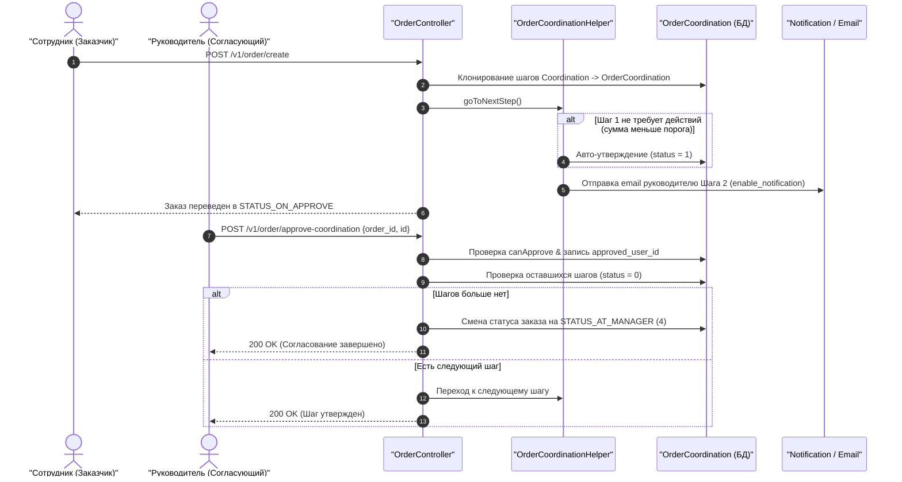

# Механизм: Процесс утверждения («Узгодження» / Matching)

## 1. Назначение механизма
Механизм **«Узгодження» (Coordination / Matching)** — это настраиваемый многоуровневый маршрут согласования заявок на закупку внутри компании клиента. Он позволяет руководству контролировать расходы, лимиты бюджетов и нестандартные закупки до того, как заказ будет отправлен поставщику.

Настраивается в интерфейсе: [`salvi_front/src/views/matching/matching.vue`](file:///C:/Users/Admin/PhpstormProjects/salvi_back/salvi_front/src/views/matching/matching.vue) и модалке [`create__matching.vue`](file:///C:/Users/Admin/PhpstormProjects/salvi_back/salvi_front/src/views/matching/create__matching.vue).

---

## 2. Главный триггер: Включение согласования для компании

Согласование работает **только если в настройках компании включен тумблер**:
* **Поле БД:** `company.coordination = 1`
* **UI настройка:** [`salvi_front/src/views/setting-company-page.vue:45`](file:///C:/Users/Admin/PhpstormProjects/salvi_back/salvi_front/src/views/setting-company-page.vue#L45) (*«Процес затвердження: Процес налаштування кроків підтвердження запиту на закупівлю вищестоящими особами»*).

> [!IMPORTANT]
> Если у компании `company.coordination = 0`, созданный заказ **минует статус `STATUS_ON_APPROVE`** и сразу переходит к менеджеру Salvi.

---

## 3. Настройка шагов согласования (Модель `Coordination`)

Каждый шаг согласования описывается моделью [`common\models\Coordination`](file:///C:/Users/Admin/PhpstormProjects/salvi_back/common/models/Coordination.php) и содержит набор строгих правил:

### 3.1. Условия по сумме заказа (`type` и `sum`):
* **`TYPE_ALL = 1` («Для всех сумм»):** шаг срабатывает независимо от итоговой суммы заказа.
* **`TYPE_LESS_OR_EQUAL = 2` («Меньше или равно»):** шаг активируется, только если `total_sum <= sum`.
* **`TYPE_BIGGER = 3` («Больше суммы»):** шаг активируется, только если `total_sum > sum` (например, закупки свыше 50 000 грн требуют подписи финансового директора).

### 3.2. Дополнительные условия (`additional_type`):
* **`ADD_TYPE_NOTHING = 1` («Без дополнительных условий»):** срабатывает всегда, если подошло условие по сумме.
* **`ADD_TYPE_HIGHER_THAN_BUDGET = 2` («Превышение бюджета»):** шаг активируется, **только если доступный остаток бюджета меньше суммы заказа** (`availableSum < 0`). Если бюджет не превышен, этот шаг автоматически пропускается.
* **`ADD_TYPE_WITHOUT_BUDGET = 3` («Заказ без бюджета»):** шаг активируется, только если клиент оформил заказ с флагом `non_budget_order = 1` (в обход планового бюджета).
* **`ADD_TYPE_CATALOG_PRODUCT = 4` («Есть товары из каталога»):** шаг активируется, только если в заказе присутствуют стандартные номенклатурные товары каталога.

### 3.3. Назначение согласующих лиц:
* **Флаг `all_roles = 1` («Все пользователи данных ролей»):**
  Любой активный сотрудник компании, имеющий одну из назначенных ролей (`roles[]`), имеет право утвердить этот шаг.
* **Флаг `all_roles = 0` («Конкретные пользователи»):**
  Утвердить шаг могут только пользователи, явно выбранные в списке `users[]`.
* **Флаг `enable_notification = 1`:** отправлять email-уведомление согласующим лицам при наступлении их очереди.

---

## 4. Жизненный цикл согласования в заказе

### Шаг 1: Клонирование шаблона шагов в заказ
При оформлении заказа ([`OrderForm::create()`](file:///C:/Users/Admin/PhpstormProjects/salvi_back/api/models/forms/OrderForm.php#L330-L380)):
1. Из таблицы `coordination` выбираются все активные шаги компании:
   `Coordination::find()->where(['company_id' => $company->id, 'status' => 1])->orderBy('order ASC')->all()`.
2. В момент создания заказа для него создаются **персональные слепки шагов**:
   * Таблица `order_coordination` (`OrderCoordination`) — статус `status = 0` (не согласован).
   * Таблица `order_coordination_roles` (`OrderCoordinationRoles`).
   * Таблица `order_coordination_users` (`OrderCoordinationUsers`).
3. Заказ переходит в статус `STATUS_ON_APPROVE` (ID: 1, цвет Красный).

---

### Шаг 2: Автоматическая проверка и пропуск шагов (`OrderCoordinationHelper`)
Сразу после создания или перехода вызывается [`OrderCoordinationHelper::goToNextStep()`](file:///C:/Users/Admin/PhpstormProjects/salvi_back/api/services/OrderCoordinationHelper.php#L88-L118). 

**Шаг АВТОМАТИЧЕСКИ ПРОПУСКАЕТСЯ (утверждается системой), если:**
* Шаг настроен на «Превышение бюджета», а бюджет в норме (`availableSum >= 0`).
* Шаг настроен на «Безбюджетный заказ», а заказ оформлен с бюджетом.
* Шаг настроен на сумму `> X`, а сумма заказа меньше.
* В компании **нет ни одного активного пользователя** с требуемой ролью или ID.

Если шаг не подходит под условия, система вызывает `$this->approve($coordination)` и сразу переходит к следующему шагу!

---

### Шаг 3: Действие пользователя на фронтенде
В интерфейсе просмотра заказа ([`salvi_front/src/views/orders/order__page.vue`](file:///C:/Users/Admin/PhpstormProjects/salvi_back/salvi_front/src/views/orders/order__page.vue#L486-L560)):
1. Компонент запрашивает через GraphQL список шагов `orderCoordination(order_id)`.
2. Отображается интерактивный степпер цепочки согласования (`matchingStep`).
3. Проверяется вычисляемое поле:
   `can_approve_next_coordination` ([`OrderCoordination::getCanApprove()`](file:///C:/Users/Admin/PhpstormProjects/salvi_back/common/models/OrderCoordination.php#L107-L132)).
4. **Кнопка «Узгодити» становится активной, ТОЛЬКО ЕСЛИ:**
   * У пользователя есть право `coordinationApproveOrder` (суперадмин), **ИЛИ**
   * Роль пользователя входит в `roles[]` текущего активного шага, **ИЛИ**
   * ID пользователя входит в `users[]` текущего активного шага.
5. При клике отправляется запрос: `POST /v1/order/approve-coordination` `{id, order_id}`.

---

### Шаг 4: Финализация согласования
Когда согласующий подписывает шаг:
1. Записывается `approved_user_id = user.id`, `status = 1`, `updated_at = time()`.
2. Проверяется наличие следующего несогласованного шага (`status = 0`).
3. **Если это был последний шаг:**
   * Вызывается `$order->changeStatusOnAtSupplier()` (или `$order->changeStatusOnAtManager()`).
   * Заказ переходит в статус **`STATUS_AT_MANAGER`** (ID: 4, «На затвердженні постачальником») или **`STATUS_AT_SUPPLIER`** (ID: 2, «Передане постачальнику»).
   * Внутреннее согласование компании завершено!

---

## 5. Схема потока согласования (Sequence Diagram)

