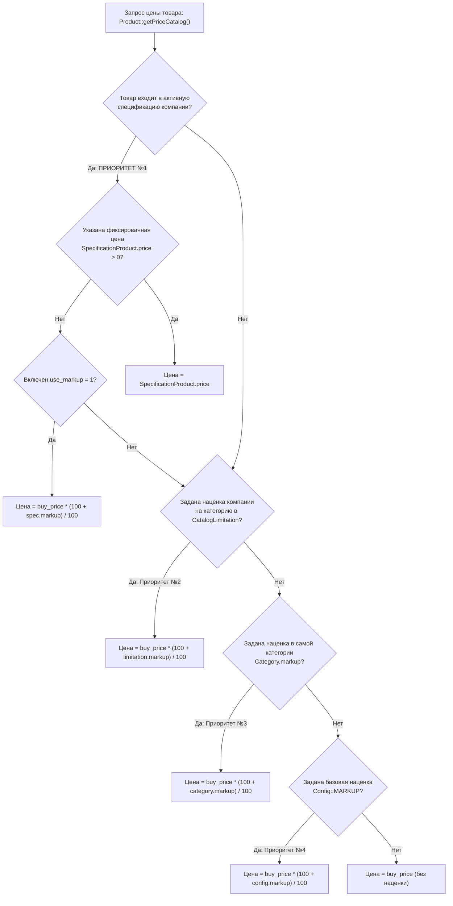

# Механизм: Настройки компаний, ценовая политика и Спецификации

## 1. Назначение механизма
Определяет индивидуальные бизнес-правила работы каждого B2B-клиента на платформе:
1. **Права и функциональные флаги компании** (доступ к каталогу, бюджетам, «пустой строке», согласованию).
2. **Ценовая политика по категориям (`CatalogLimitation`)**: индивидуальные наценки и скрытие категорий.
3. **Контрактные спецификации (`Specification`)**: жесткая фиксация договорных цен на утвержденный список товаров для конкретных локаций и юрлиц компании.
4. **Иерархический алгоритм расчета цены товара**.

---

## 2. Функциональные флаги компании (Модель `Company`)

Все глобальные права компании хранятся в таблице `company` ([`common\models\Company`](file:///C:/Users/Admin/PhpstormProjects/salvi_back/common/models/Company.php)) и настраиваются на странице компании во фронтенде ([`salvi_front/src/views/setting-company-page.vue`](file:///C:/Users/Admin/PhpstormProjects/salvi_back/salvi_front/src/views/setting-company-page.vue)):

| Флаг в БД | Название в интерфейсе UI | Что контролирует и на что влияет |
| :--- | :--- | :--- |
| **`empty_string`** | **Порожній рядок для товара** | Позволяет пользователю добавить в корзину кастомный товар не из каталога (ввести название, ориентировочную цену, ссылку в интернете и комментарий). Такой заказ автоматически уходит на модерацию (`STATUS_MODERATION`). |
| **`non_budget_order`**| **Замовлення без бюджету** | Позволяет сотрудникам оформлять закупки в обход лимитов бюджетирования. При этом для таких заказов может активироваться особый шаг согласования (`ADD_TYPE_WITHOUT_BUDGET`). |
| **`budgets`** | **Бюджетування** | Включает проверку лимитов ЦФО (Cost Centers) и периодов бюджетов. При превышении заказ блокируется или отправляется на дополнительное согласование. |
| **`coordination`** | **Процес затвердження (Matching)** | Включает многоуровневый процесс согласования заказов руководством компании клиента перед отправкой поставщику. |
| **`po_number_required`**| **Обов'язкове поле №РО** | Делает поле *Purchase Order Number (№ РО / номер заявки клиента)* обязательным при оформлении заказа в корзине. Без него заказ не создается. |
| **`show_catalog`** | **Показувати каталог** | Разрешает или запрещает компании видеть общий каталог Salvi. Если отключено, компания работает только по согласованным спецификациям. |
| **`catalog_limitation`**| **Обмеження каталогу** | Включает индивидуальную матрицу доступа и наценок по категориям каталога. |
| **`new_category`** | **Доступ до нових категорій** | Автоматически открывает компании доступ к новым категориям товаров, появляющимся при выгрузке из 1С. |

---

## 3. Ценовая политика и ограничения каталога (`CatalogLimitation`)

Управляется в интерфейсе [`salvi_front/src/views/price-policy/table__price-policy.vue`](file:///C:/Users/Admin/PhpstormProjects/salvi_back/salvi_front/src/views/price-policy/table__price-policy.vue) и сохраняется в модели [`common\models\CatalogLimitation`](file:///C:/Users/Admin/PhpstormProjects/salvi_back/common/models/CatalogLimitation.php).

Для каждой пары `(company_id, category_uuid)` задаются параметры:
* **`markup` (Наценка в %):** персональная коммерческая наценка Salvi для данной компании на конкретную ветку товаров.
* **`for_show` (0 или 1):** видимость категории. Если `for_show = 0`, товары этой категории полностью исключаются из выдачи для всех сотрудников компании.
* **`location_id`:** привязка правила к определенному филиалу компании (если наценки зависят от региона доставки).

---

## 4. Контрактные спецификации (`Specification`)

Управляются в интерфейсе [`salvi_front/src/views/specification/specification__table.vue`](file:///C:/Users/Admin/PhpstormProjects/salvi_back/salvi_front/src/views/specification/specification__table.vue).

Спецификация фиксирует юридические договоренности между Salvi и клиентом:
* **Привязка:** жестко связывается с договором (`contract_id`), компанией (`company_id`) и списком утвержденных локаций (`SpecificationLocation`).
* **Срок действия:** поля `date_start` и `date_end`. За пределами этих дат спецификация автоматически деактивируется.
* **Товары и цены ([`SpecificationProduct`](file:///C:/Users/Admin/PhpstormProjects/salvi_back/common/models/SpecificationProduct.php)):**
  * `price` — фиксированная специальная цена на товар (в гривнах).
  * `use_markup` и `markup` — альтернативный вариант: фиксированный процент наценки на цену закупки 1С для данного товара.

### Режим «Только спецификация» (`specification_only`):
Если в каталоге или бюджете установлен флаг `specification_only = 1`:
* Клиент видит в каталоге **исключительно те позиции**, которые внесены в активную спецификацию его локации.
* Все остальные 50 000+ товаров общего каталога скрываются.

---

## 5. Иерархия расчета цены товара (`Product::getPriceCatalog`)

Когда товар отображается в каталоге, корзине или заказе, его финальная цена рассчитывается в [`common\models\Product::getPriceCatalog()`](file:///C:/Users/Admin/PhpstormProjects/salvi_back/common/models/Product.php#L211-L290) по строгому правилу приоритетов:

> [!NOTE]
> **Главное правило:** Спецификация всегда обладает абсолютным приоритетом. Если товар внесен в спецификацию клиента с фиксированной ценой, никакие наценки каталога или изменения цен в 1С не влияют на стоимость для этого клиента.
