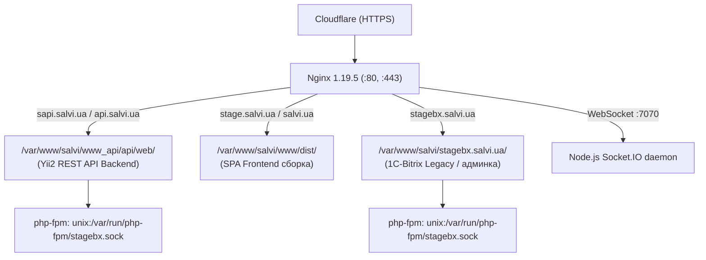
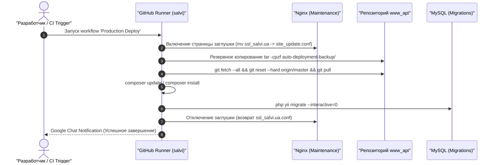

# Инфраструктура, сервера и сервисы (Stage & Prod)

В данном документе зафиксировано актуальное состояние серверной инфраструктуры проекта **Salvi**, полученное в ходе анализа stage-окружения (`stage.salvi.ua`). Архитектура production идентична по структуре и версиям компонентов.

---

## 1. Сводная таблица компонентов и версий

| Компонент / Сервис | Версия на сервере | Порт / Сокет | Назначение / Описание |
| :--- | :--- | :--- | :--- |
| **Операционная система** | CentOS Linux 7.9.2009 (Core) | — | Ядро Linux: `3.10.0-1160.6.1.el7.x86_64` |
| **Web-сервер (Nginx)** | Nginx 1.19.5 | `80`, `443` (HTTP/2) | Обратный прокси, раздача статики, SSL Cloudflare |
| **PHP Runtime** | PHP 7.3.25 (cli / fpm) | `/var/run/php-fpm/*.sock` | Zend OPcache v7.3.25, расширения: `redis`, `gd`, `pdo_mysql`, `zip` |
| **СУБД (MySQL)** | MySQL 5.7.32 | `3306` (127.0.0.1) | Основная база данных (`salvidb`) |
| **Кэш и очереди (Redis)** | Redis server 6.0.9 | `6379` (127.0.0.1) | Очереди задач Yii2 (`queue`), Pub/Sub для WebSockets |
| **Поисковый движок** | Elasticsearch 7.x | `9200` (116.203.191.217) | Выделенный сервер поискового индекса каталога товаров |
| **WebSocket сервер** | Node.js v10.23.0 | `7070` | Socket.IO 2.2 + Express + Redis Subscriber под управлением `forever` |
| **Почтовый транспорт** | Postfix + MiroHost SMTP | `587` (TLS) | Отправка почты (`mx1.mirohost.net:587`, SwiftMailer) |
| **SFTP-шлюз (1С / Каталог)** | OpenSSH SFTP | `22321` | Удаленный сервер `94.130.177.104` для обмена прайс-листами 1С |
| **CI/CD Агент** | GitHub Actions Runner | Systemd | Self-hosted runner (`actions.runner.KDTeam-2143-Team-Tool.salvi.service`) |
| **Мониторинг** | Zabbix Agent 2 | `10050` | Мониторинг производительности и доступности сервера |

---

## 2. Структура виртуальных хостов Nginx

На сервере сконфигурированы следующие виртуальные хосты в `/etc/nginx/conf.d/`:



### Детали виртуальных хостов:

1. **`sapi.salvi.ua` (API Backend):**
   * **Root:** `/var/www/salvi/www_api/api/web/`
   * **Точка входа:** `index.php`
   * **FastCGI:** сокет `unix:/var/run/php-fpm/stagebx.sock` (таймауты до `12000s` для тяжелых отчетов)
   * **CORS:** заголовок `Access-Control-Allow-Origin: https://stage.salvi.ua`

2. **`stage.salvi.ua` (Frontend):**
   * **Root:** `/var/www/salvi/www/dist/`
   * **Маршрутизация:** Single Page Application (`try_files $uri $uri/ /index.html$is_args$args;`)

3. **`stagebx.salvi.ua` (1С-Битрикс):**
   * **Root:** `/var/www/salvi/stagebx.salvi.ua`
   * Поддержка стандартных правил маршрутизации Битрикс (`/bitrix/urlrewrite.php`)

---

## 3. Пулы процессов PHP-FPM (`/etc/php-fpm.d/`)

* **`salvi_api`** (Пользователь: `salvi`): пул, предназначенный для выполнения запросов API Yii2.
* **`stagebx`** (Пользователь: `salvi`): общий FastCGI пул для Bitrix и API.
* **`www`** (Пользователь: `nginx`): системный пул по умолчанию.

---

## 4. Фоновые демоны и службы (Systemd / Forever)

### 1. WebSocket Демон (Node.js)
* **Скрипт управления:** `/var/www/salvi/node.sh`
* **Команды управления:**
  ```bash
  /var/www/salvi/node.sh START  # Запуск демона
  /var/www/salvi/node.sh STOP   # Остановка
  /var/www/salvi/node.sh LIST   # Статус forever
  ```
* **Каталог проекта:** `/var/www/salvi/www_api/nodejs`
* **Команда запуска:** `forever start -c "npm start" "index.js"`
* **Слушает порт:** `7070`
* **Автостарт:** прописан в crontab через `@reboot cd /var/www/salvi/ && ./node.sh START`

### 2. Воркер очередей (Yii Queue Worker)
* **Юнит Systemd:** `/etc/systemd/system/yii-queue@.service`
* **Команда запуска:**
  ```bash
  /usr/bin/php /var/www/salvi/www_api/yii queue/listen --verbose
  ```
* **Пользователь запуска:** `salvi:salvi`
* **Управление службой:**
  ```bash
  systemctl status yii-queue@1
  systemctl restart yii-queue@1
  ```

### 3. GitHub Actions Runner
* **Юнит Systemd:** `/etc/systemd/system/actions.runner.KDTeam-2143-Team-Tool.salvi.service`
* **Пользователь запуска:** `ghrunner`
* **Каталог:** `/home/ghrunner/runsvc.sh`
* Обеспечивает выполнение workflow деплоя прямо на целевой сервер без сторонних агентов.

---

## 5. Планировщики задач Crontab и системные Cron-скрипты

На сервере используется два уровня планирования задач: пользовательский Crontab и системный каталог `/etc/cron.hourly/`.

### 5.1. Системный почасовой скрипт: `/etc/cron.hourly/1elasicindexrecreate`
Скрипт выполняется операционной системой каждый час от имени root и последовательно запускает три критических фоновых механизма:

```bash
#!/bin/sh
/usr/bin/php /var/www/salvi/www_api/yii search/update-table create >> /var/www/salvi/www_api/update-table.txt
/usr/bin/php /var/www/salvi/www_api/yii contract >> /var/www/salvi/www_api/contract.txt
/usr/bin/php /var/www/salvi/www_api/yii clear-logs >> /var/www/salvi/www_api/clear-logs.txt
```

| Команда | Контроллер / Метод | Лог-файл | Назначение |
| :--- | :--- | :--- | :--- |
| `search/update-table create` | `console\controllers\SearchController::actionUpdateTable('create')` | `update-table.txt` | Агрегация товаров в MySQL-таблицу `elastic_search_source`, пересоздание индекса и выгрузка в Elasticsearch (`116.203.191.217:9200`). |
| `contract` | `console\controllers\ContractController::actionIndex()` | `contract.txt` | Проверка истекающих контрактов (за 7 дней до `date_end`) и рассылка уведомлений клиентам. |
| `clear-logs` | `console\controllers\ClearLogsController::actionIndex()` | `clear-logs.txt` | Автоматическая ротация: удаление `integration.log` (> 400MB), чистка уведомлений > 30 дней, логов импорта товаров и спецификаций > 3 месяцев. |

### 5.2. Расписание Crontab пользователя `salvi`
Файл расписания: `/var/spool/cron/salvi`

| Расписание | Команда | Назначение |
| :--- | :--- | :--- |
| `0 0 * * *` | `php /var/www/salvi/www_api/yii budget/index;` | **Ежедневный пересчет бюджетов в 00:00:** открывает актуальные бюджеты и переводит истекшие в статус `INACTIVE`. |
| `* * * * *` | `test -f var/www/salvi/stagebx.salvi.ua/.../cron_events.php && ...` | Минутный запуск периодических фоновых агентов 1С-Битрикс. |
| `@reboot` | `cd /var/www/salvi/ && ./node.sh START` | Автоматический подъем Node.js сокет-сервера после перезагрузки ОС. |

---

## 6. Процесс CI/CD (Production Deploy Flow)

Деплой реализован через GitHub Actions Workflow (`.github/workflows/main.yml`) на основе self-hosted runner:


